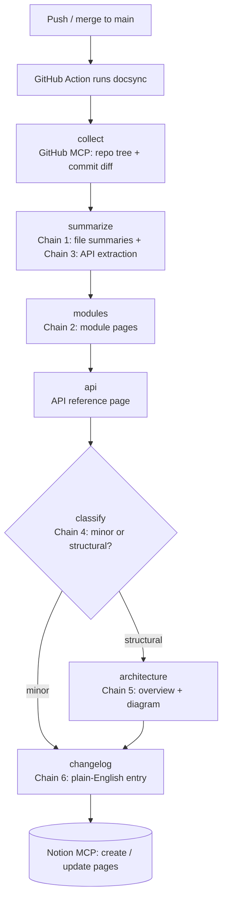

# DocSync

**An AI documentation agent that reads your codebase through the GitHub MCP server, writes architecture docs, module guides and an API reference into Notion through the Notion MCP server, and keeps them in sync on every merge.**

Built with **LangGraph + LangChain**, running on an open-source LLM (**NVIDIA Nemotron via OpenRouter**).

---

## The problem

Documentation goes stale. The code changes daily; the docs get written once and forgotten. New engineers read outdated pages or interrupt a senior engineer.

DocSync treats docs like a build artifact: every merge to `main` re-documents what changed, and only what changed.

## What you get in Notion

```
<your root page>
 ├── Architecture Overview   summary, Mermaid diagram, components, data flow, tech stack
 ├── API Reference           every HTTP endpoint: method, path, params, response, source file
 ├── Changelog               one plain-English entry per merge, newest first
 └── Modules
      ├── api                one page per top-level module, with a per-file reference
      └── core
```

## How it works



| # | Chain | Input → Output | Pattern |
|---|---|---|---|
| 1 | File summariser | source file → purpose, key symbols, dependencies | map |
| 2 | Module writer | file summaries of a folder → module page | reduce |
| 3 | API extractor | route file → endpoints (FastAPI, Flask, Express, Next.js, Spring, NestJS, Django, Go) | extraction |
| 4 | Change classifier | commit messages + diff → `minor` / `structural` | routing |
| 5 | Architecture writer | all module docs + manifests → overview + Mermaid diagram | synthesis |
| 6 | Changelog writer | commits + diff → plain-English entry | summarisation |

Every chain returns a **validated Pydantic object**; Markdown is rendered by code, not by the model, so page layout is always consistent.

## Engineering details

- **Incremental sync.** Each file's content hash and summary are cached (`.docsync/state.json`, persisted between CI runs with `actions/cache`). Unchanged files are never sent to the LLM again, which keeps a free-tier model usable.
- **Hallucination checks.** After summarising a file, every symbol the model mentions is checked against the source. If it invented names, it gets one retry with the bad names listed; whatever still can't be verified is dropped. Endpoints are verified the same way, and an invalid Mermaid diagram is replaced with a dependency graph built from the import lists.
- **Cheap routing.** The "is this an architecture change?" decision tries deterministic rules first (new/removed module, changed `package.json` / `pyproject.toml` …) and only asks the LLM when the rules can't decide.
- **Robust structured output.** Open models don't all support strict JSON-schema mode, so DocSync parses JSON itself (handling `<think>` blocks and code fences) and sends validation errors back to the model for one self-correction.
- **Provider-agnostic LLM.** Any OpenAI-compatible endpoint: OpenRouter by default, NVIDIA NIM by changing `LLM_BASE_URL`. Rate limiting, retries and a fallback model (`openrouter/free`) are built in.
- **Least-privilege MCP.** The GitHub MCP connection requests only the read-only `repos` and `git` toolsets.
- **Idempotent Notion writes.** Pages are found by title under the root page and updated in place (Notion's markdown endpoint), never duplicated. Deleted modules have their page moved to trash.
- **Fault isolation.** A file that fails to parse is logged and skipped; it doesn't fail the run.

## Project layout

```
src/docsync/
  cli.py          entry point: `docsync run`, `docsync tools`
  graph.py        the LangGraph pipeline (nodes + conditional routing)
  chains.py       the six chains
  prompts.py      prompt templates
  schemas.py      Pydantic output models
  llm.py          OpenAI-compatible client, rate limiting, fallback, JSON repair
  mcp_client.py   GitHub + Notion MCP connections (langchain-mcp-adapters)
  sources.py      code sources: GitHub MCP, local folder
  sinks.py        doc targets: Notion MCP, local Markdown
  analysis.py     module grouping, route detection, hallucination checks
  render.py       deterministic Markdown rendering
  state.py        hash cache for incremental runs
tests/            pipeline tests with a fake LLM (no API keys needed)
```

## Setup

### 1. Keys you need

| What | Where | Env var |
|---|---|---|
| OpenRouter API key | [openrouter.ai/keys](https://openrouter.ai/keys) | `OPENROUTER_API_KEY` |
| GitHub token (fine-grained, *Contents: read* on the repo) | GitHub → Settings → Developer settings → Personal access tokens | `GITHUB_TOKEN` |
| Notion integration token | [notion.so/profile/integrations](https://www.notion.so/profile/integrations) → New internal integration | `NOTION_TOKEN` |
| Notion root page ID | Create a page, then **⋯ → Connections → add your integration**; copy the page URL | `NOTION_ROOT_PAGE_ID` |

`NOTION_ROOT_PAGE_ID` accepts the page URL, a raw ID or a dashed ID.

### 2. Run locally

```bash
python -m venv .venv && source .venv/bin/activate
pip install -e ".[dev]"
cp .env.example .env   # fill in your keys
```

Try it with only an LLM key (local folder in, Markdown files out):

```bash
docsync run --local . --out docs_out
```

The real thing (GitHub MCP in, Notion MCP out):

```bash
docsync run --full
```

See which tools each MCP server exposes:

```bash
docsync tools
```

### 3. Keep docs in sync on every merge

`.github/workflows/docsync.yml` runs on every push to `main` and documents the repo it lives in. Add these under **Settings → Secrets and variables → Actions**:

- Secrets: `OPENROUTER_API_KEY`, `NOTION_TOKEN`, `NOTION_ROOT_PAGE_ID`, `DOCSYNC_GITHUB_TOKEN`
- Optional variable: `DOCSYNC_MODEL` (defaults to `nvidia/nemotron-3-super-120b-a12b:free`)

Run it once by hand (**Actions → DocSync → Run workflow**) for the first full build; after that, each push updates only what changed. To document a different repo, copy the workflow into that repo.

## Choosing a model

Any OpenRouter model that follows instructions well and handles long inputs works. Defaults:

- **Primary:** `nvidia/nemotron-3-super-120b-a12b:free`, a strong open model with a long context window
- **Fallback:** `openrouter/free`, which routes to whichever free model is available

Free models are rate-limited and the free catalogue changes, so if a model ID stops working, pick another from [openrouter.ai/models](https://openrouter.ai/models?max_price=0) and set `DOCSYNC_MODEL`. Tune `DOCSYNC_REQUESTS_PER_SECOND` and `DOCSYNC_MAX_CONCURRENCY` to stay under your limits.

## Tests

```bash
pytest -q
```

The suite runs the whole LangGraph pipeline against a throwaway git repo with a fake LLM. It checks the full build, cache hits (zero LLM calls on unchanged code), incremental runs, routing for minor vs. structural changes, deleted-module cleanup, hallucination filtering and the Notion page create/update logic.

## License

MIT
